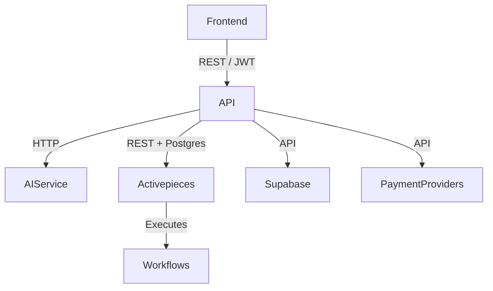

## Overview

Gravity is a polyglot monorepo with three independently deployable applications: a Remix frontend, a NestJS API, and a FastAPI AI service. The platform supports agent creation from workflow templates, marketplace discovery and execution, subscription billing with credit entitlements, creator earnings and payouts, referral programs, bounties, and an automated quality review pipeline.

<Callout kind="info">

The three services share a monorepo but run independently. The frontend communicates with the API through REST, and the API delegates AI-related work to the AI service.

</Callout>

## Service architecture

### Frontend (Remix)

The Remix frontend provides the product experience for creators, consumers, reviewers, and administrators. It connects to the API through authenticated REST requests and presents the workflows, marketplace operations, billing tools, and review feedback required to use Gravity end to end.

The frontend supports:

- **Authentication and onboarding:** Email and password, one-time passwords, Google OAuth, session handling, and profile management.
- **Agent marketplace:** Browse agents, inspect agent details, clone agents, and start live runs.
- **Agent creation:** Create and customize agents through a guided workflow wizard.
- **Builder dashboard:** Review agent performance, earnings, payout settings, and quality review feedback.
- **Consumer dashboard:** Manage saved applications and scheduled agents.
- **Connection management:** Configure OAuth connections, API keys, and Activepieces connections.
- **Consumer inputs:** Render dynamic forms for text, dates, files, dropdowns, cascades, arrays, JSON values, and schedules.
- **Paused runs:** Display runs paused for human approval, configured delays, or AI-agent waitpoints.
- **Execution output:** Render text, files, images, PDFs, and structured values returned by marketplace runs.
- **Credits and billing:** Purchase credit top-ups, manage subscriptions, review usage, and complete checkout.
- **Community and growth:** Access bounties, requested agents, leaderboards, and notifications.
- **Administration:** Review agents, manage quality reviews, oversee billing operations, and manage referrals.

### API (NestJS)

The NestJS API is the main application and domain service. It coordinates authentication, agent lifecycle management, marketplace execution, billing, creator economics, integrations, and administrative workflows.

#### Authentication

The authentication module handles signup, login, one-time passwords, password resets, Google OAuth, and session management through Supabase JWTs. The API validates authenticated requests and provides the identity context used by user, creator, consumer, and administrative workflows.

#### Agents

The agent module manages agent creation, publishing, and verification. It supports duplicate detection, review workflows, verification state transitions, and feedback from quality reviews to the agent builder.

#### Marketplace execution

The marketplace module manages the complete consumer execution lifecycle:

- Agent catalog and discovery
- Agent cloning and workflow import
- Consumer runs and scheduled execution
- Trigger resolution
- Connection discovery
- Output normalization
- Cost estimation
- Run polling
- Paused-run classification
- File proxying

This module translates consumer intent into workflow execution and returns normalized results that the frontend can render across supported output types.

#### Billing and entitlements

The billing module manages credits, subscriptions, usage entitlements, and payment flows. It supports Razorpay and Stripe for pay-ins, as well as payout accounts and withdrawal workflows for creators.

#### Earnings

The earnings module tracks creator balances and payout activity. It provides currency conversion through foreign exchange rates and exposes paginated earnings history for creators and administrative workflows.

#### Referrals

The referrals module manages share links, referral attribution, monthly settlement, and referral earnings. It connects referral activity to the billing and earnings systems.

#### Bounties

The bounties module supports bounty creation, funding, agent submissions, review workflows, and payouts. It provides a structured path for requesting and rewarding new agent capabilities.

#### Activepieces integration

The Activepieces integration module connects Gravity to the workflow execution platform. It manages flows, connections, OAuth, user provisioning, capability probing, and custom-piece registration.

#### Health

Health endpoints expose service availability for operational monitoring and deployment checks.

### AI service (FastAPI)

The FastAPI AI service handles AI-related functionality that supports discovery, verification, review, and content generation. The API delegates AI-assisted work to this service over HTTP.

The AI service provides:

- **Intent detection and conversational routing:** Interpret user requests and route them to the appropriate product workflow.
- **Agent search and recommendation:** Find relevant agents and rank recommendations based on user needs.
- **Agent verification:** Run behavioral, code, network and domain, guardrail, health, AI reviewer, request-alignment, and setup-field checks.
- **Multi-phase agent review:** Score agents across evidence axes and combine review signals into quality decisions.
- **Content generation:** Create agent descriptions, categories, and fillable fields.
- **Guide and help responses:** Generate contextual guidance for agent usage and product workflows.
- **Pricing and provider lookup:** Retrieve information used for cost estimation and provider selection.

## Cross-service communication

Gravity separates user interaction, domain orchestration, AI processing, workflow execution, and infrastructure services across explicit integration boundaries.

- **Frontend to API:** The frontend makes REST calls with Bearer JWT authentication.
- **API to AI service:** The API makes HTTP calls for verification, review, intent handling, recommendations, and AI-assisted content generation.
- **API to Activepieces:** The API uses REST for flow management, connections, and execution. It reads workflow and run data directly from Activepieces Postgres and uses Socket.IO for test runs.
- **API to payment providers:** Razorpay and Stripe process pay-ins. RazorpayX, PayPal, and Stripe Connect support creator payouts.
- **API to Supabase:** Supabase provides authentication and JWT verification, along with platform persistence.

## External integrations

Gravity integrates with the following external systems:

- **Activepieces:** Workflow execution, flow management, connections, OAuth, and run handling.
- **Supabase:** Authentication, JWT verification, and platform persistence.
- **OpenRouter:** LLM routing across supported model providers.
- **Stripe and Razorpay:** Customer payments, subscriptions, and credit purchases.
- **RazorpayX, PayPal, and Stripe Connect:** Creator payouts and withdrawals.
- **Composio:** Tool integrations used by agents and workflows.

## Persistence

Gravity uses Supabase for authentication and platform persistence. Supabase stores the application data required for identities, profiles, billing-related records, marketplace workflows, creator economics, referrals, bounties, and review state.

The platform also integrates with Activepieces' Postgres database for workflow and run data. This gives the API access to execution state needed for run polling, paused-run classification, output retrieval, and workflow operations.

## Related pages

<Columns cols={2}>
  <Card title="Features" href="/features" icon="code">

    Explore the product capabilities available to creators, consumers, and administrators.

  </Card>
  <Card title="Monorepo architecture" href="/monorepo-architecture" icon="folder">

    Review how the repository organizes the frontend, API, AI service, and shared development workflows.

  </Card>

  <Card title="NestJS API" href="/api-reference/nestjs-api" icon="terminal">

    Reference the API modules and endpoints that power Gravity's application workflows.

  </Card>
  <Card title="Integrations" href="/integrations" icon="cloud">

    Configure the external services that support authentication, workflow execution, AI, payments, and payouts.

  </Card>
</Columns>