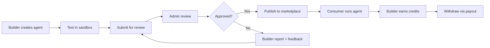

## Overview

Gravity is a platform for building, publishing, and running AI-powered workflow agents. Builders create agents from automation workflows, submit them for review, and earn credits when consumers run their agents.

Consumers browse the marketplace, connect their accounts, and run agents on demand or on a schedule. Gravity manages billing, credits, earnings, payouts, referrals, and workflow execution across the platform.

## Feature grid

<Columns cols={3}>
  <Card title="Agent Marketplace" icon="store" href="/api-reference/nestjs-api">
    Browse, discover, and run published AI workflow agents. Filter by category, search by keyword, and view workflow details before running.
  </Card>
  <Card title="Agent Builder" icon="wrench" href="/api-reference/nestjs-api">
    Create agents from automation workflows. Test in a builder sandbox, generate descriptions and categories with AI assistance, and publish to the marketplace.
  </Card>
  <Card title="Review Pipeline" icon="shield-check" href="/api-reference/nestjs-api">
    Submitted agents go through admin review with quality checks, evidence-backed findings, and builder feedback. Admins can approve, reject, re-review, and send builder reports.
  </Card>
  <Card title="Agent Verification" icon="scan-search" href="/api-reference/nestjs-api">
    Safety verification includes static analysis, guardrail checks, URL safety screening, and real-time streaming verification results.
  </Card>
  <Card title="Subscriptions" icon="credit-card" href="/api-reference/nestjs-api">
    Choose a plan, check out through Razorpay or Stripe based on region, track entitlements and credits, and cancel at period end.
  </Card>
  <Card title="Credits" icon="coins" href="/api-reference/nestjs-api">
    Purchase credit packages, track balances and charges, and verify orders. Credits power agent runs on a pay-as-you-go basis.
  </Card>
  <Card title="Creator Earnings" icon="trending-up" href="/api-reference/nestjs-api">
    Builders earn credits when consumers run their agents. Track lifetime earnings, withdrawn amounts, and withdrawable balances.
  </Card>
  <Card title="Payouts" icon="banknote" href="/api-reference/nestjs-api">
    Withdraw earnings through bank transfer, UPI, PayPal, or Stripe Connect. Concurrency-safe balance checks prevent double withdrawals.
  </Card>
  <Card title="Referrals" icon="share-2" href="/api-reference/nestjs-api">
    Share agent links, attribute referrals on first run, and earn referral credits monthly based on referred users' activity.
  </Card>
  <Card title="Workflow Execution" icon="play-circle" href="/api-reference/nestjs-api">
    Run agents on demand or on a schedule. Approval waitpoints pause runs until a human approves. Paused runs stay alive for extended polling windows.
  </Card>
  <Card title="OAuth Connections" icon="link" href="/integrations">
    Connect third-party apps through OAuth. Gravity supports Google, Slack, Notion, GitHub, Microsoft, and dozens of other providers.
  </Card>
  <Card title="Notifications" icon="bell" href="/configuration-reference">
    Receive in-app and email notifications for review updates, low-credit warnings, and failed scheduled runs.
  </Card>
</Columns>

## How agents flow through the platform

Agents move from builder creation through sandbox testing, review, marketplace publication, and consumer execution. Approved agents generate creator earnings when consumers run them.

## Billing and earnings model

Gravity uses credits to connect consumer activity with agent creator earnings:

- Consumers subscribe to a plan or purchase credit packages.
- Each agent run consumes credits based on the workflow's pricing.
- Credits are split between the platform and the agent's creator.
- Creators can withdraw earnings through supported payout methods.
- Referral earnings provide additional credits based on referred users' activity.

<Callout kind="info">

Subscription billing and enforcement are controlled by database-backed feature flags. When billing is disabled, subscription endpoints return 404. When enforcement is off, runs are not blocked by entitlement checks, allowing shadow-mode operation.

</Callout>

## Workflow run states

A workflow run moves through these states:

- **Running:** The workflow is actively executing.
- **Paused:** The workflow is waiting for an external condition, such as approval, a delay, or an agent waitpoint. Paused runs are not terminal and remain in progress.
- **Succeeded:** The workflow completed successfully.
- **Failed:** The workflow stopped because of an error, timeout, or resource limit.

<Callout kind="info">

When a run is paused for approval, the workflow stays active. Builders and consumers can poll for results for up to 2 hours for builders or 24 hours for consumers. Recurring agents retain their run handle while paused, so approval-based workflows continue functioning across cycles.

</Callout>

## Related docs

<Columns cols={3}>
  <Card title="API Reference" href="/api-reference/nestjs-api" icon="code">
    Browse all API endpoints.
  </Card>
  <Card title="Configuration" href="/configuration-reference" icon="settings">
    Review environment variables and feature flags.
  </Card>
  <Card title="Data Models" href="/data-models-reference" icon="database">
    Explore the database schema and data contracts.
  </Card>
</Columns>