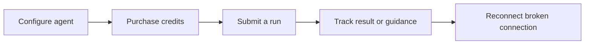

## Overview

Gravity connects guided agent configuration, paid runs, submission review, and payout management in one marketplace workflow.

<Callout kind="info">

A run waiting for approval is shown as waiting, not failed. Long-running runs remain available for tracking after the initial request.

</Callout>

## Feature grid

<Columns cols={2}>
  <Card title="Guided agent configuration" icon="settings" href="/help-center">
    Configure marketplace agents through sequential questions with text, date, file, selection, and dynamic-option inputs when required.
  </Card>
  <Card title="Run tracking and guidance" icon="bar-chart" href="/help-center">
    Review useful outputs and failure guidance while tracking runs that are waiting for approval or continue beyond the initial request.
  </Card>
  <Card title="Agent customization and review" icon="edit" href="/help-center">
    Choose which values consumers provide, reuse answers across related fields, test submissions, and review submissions before publication.
  </Card>
  <Card title="Earnings and payouts" icon="download" href="/help-center">
    View earnings and payout history, configure a payout account, check payout status, and withdraw eligible funds.
  </Card>
  <Card title="Credits for agent runs" icon="plus" href="/help-center">
    Purchase credits for agent runs, with completed payments verified before balances are updated.
  </Card>
  <Card title="Connection failure notifications" icon="alert-triangle" href="/help-center">
    Receive a notification when a scheduled agent run fails because a connection is broken, then reconnect the service.
  </Card>
</Columns>

## How the pieces fit together

Consumers answer an agent's guided questions, purchase credits when needed, and submit a run. Gravity verifies completed payments, presents the result or failure guidance, and keeps waiting or long-running runs visible for follow-up. Builders customize the questions, test submissions, review them before publication, and manage earnings and payouts.

## Recommended workflow

- **Configure** the agent by answering each guided question and providing the requested values.
- **Purchase credits** when the run requires them, then submit the agent run after payment is verified.
- **Track** the run and follow its result or failure guidance. If a scheduled run reports a broken connection, reconnect the service before the next run.

## Related links

<Columns cols={2}>
  <Card title="Help Center" icon="help-circle" href="/help-center">
    Find task-oriented articles for setup, troubleshooting, and maintenance.
  </Card>
  <Card title="Help articles" icon="book-open" href="/help-center">
    Browse focused guidance for configuring agents, using credits, managing payouts, and reconnecting services.
  </Card>
</Columns>